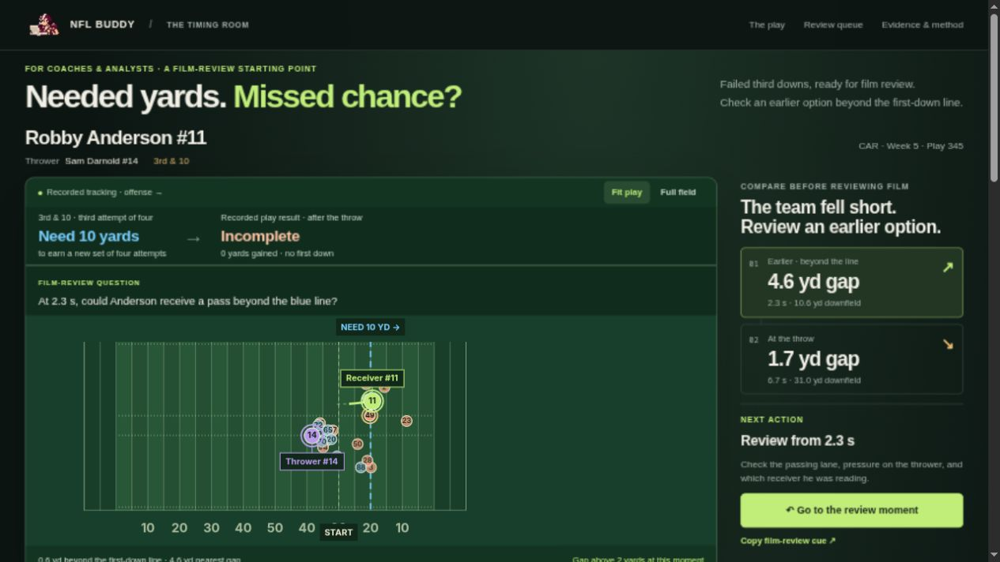
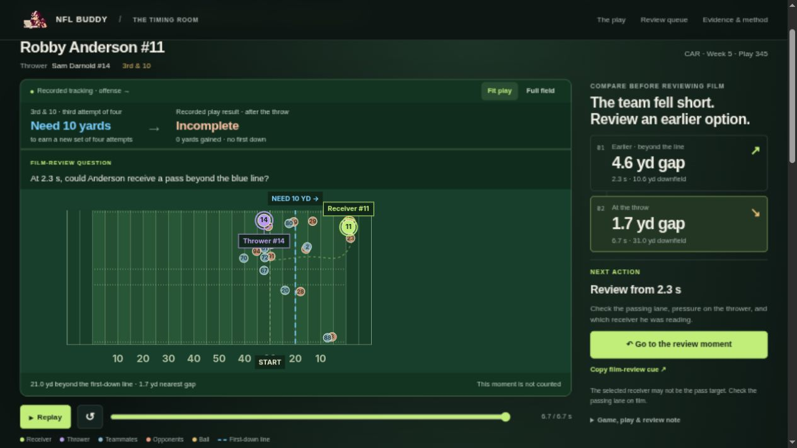

<div align="center">


# NFL Buddy 

### Failed third downs, built for NFL film review.

**See the situation. Know the result. Take one earlier moment to film.**

[](pyproject.toml)
[](outputs/multigame/report.html)
[](#data-and-scope)
[](uv.lock)
[](#development)

[Open live report](https://nflbuddy.nix.zone/) · [Questions it answers](#questions-it-answers) · [How it works](#how-it-works) · [Reproduce](#reproduce-the-analysis) · [Documentation](#documentation)

**Tracking data → Spacing history → Film-review queue**

</div>

## TL;DR

NFL Buddy helps coaches and analysts review failed third-down passes: how many yards were needed, what actually happened, and whether an earlier receiver position deserves a closer look on film.

The pitch shows the target line, recorded result and a timestamped review question together. The 50-route queue selects the longest sustained gaps beyond that line from 177 qualifying routes across 923 eligible failed third-down pass plays.

It answers **“where should I start reviewing this failure?”** Spacing alone cannot tell us a pass was available; check the passing lane, pressure and intended read on game film.



## Explore the report

**[Open NFL Buddy →](https://nflbuddy.nix.zone/)** — no installation needed. For an offline copy, follow the steps below.

### 1. Get the project

```bash
git clone https://github.com/Claken/NFL-BigData.git
cd NFL-BigData
```

### 2. Open the report

Open [`outputs/multigame/report.html`](outputs/multigame/report.html) in your browser from the cloned repository. GitHub's file viewer shows the HTML source; use the local file to interact with it.

**No Python installation or data download is needed to explore the committed report.** Its charts and replay data are embedded, so it works offline. Keep the output folder together to retain the companion CSV, findings and image links.

### 3. Review a route

1. Read **Need 10 yards → Incomplete → no first down** directly above the field.
2. Compare the **Earlier · beyond the line** and **At the throw** moments.
3. Use **Go to the review moment**, then **Copy film-review cue** for the game, play and timestamp.
4. Check the passing lane, pressure and intended read on game film. The selected receiver may not be the pass target.
5. Filter the visible **Review queue** for another failed third down. The original all-downs study remains in **Evidence & method**.



## Questions it answers

| Football question | What the report provides |
| --- | --- |
| **How did the selected play end?** | The recorded pass result and yardage, shown throughout playback; ball flight is not reconstructed |
| **What should I check after a failed third down?** | A sustained earlier moment at/beyond the first-down line, with an exact film-review cue |
| **Can a close-at-release route hide earlier spacing?** | The frequency of sustained earlier windows among eligible routes at ≤2 yards from the nearest defender at release |
| **Can similar release snapshots tell different stories?** | A matched Scott Miller pair from the same game, alignment and coverage, with contrasting spacing histories |
| **Where does this pattern appear?** | Descriptive alignment and coverage comparisons, with route counts |
| **Which plays should I review first?** | A filterable queue of 50 failed-third-down routes selected for long gaps at/beyond the first-down line |
| **Does the finding depend on the definition?** | Checks using different distance thresholds, later start times, greater downfield depth and alternative release markers |

Whether a window was a usable throw still requires film review of leverage, passing lanes, quarterback timing and the play's design.

## How it works

For each eligible receiver, the analysis recalculates the distance to the nearest of all 11 defenders at every tracking frame. It then compares the spacing history with the spacing at release.

| Rule | Failed-third-down queue |
| --- | --- |
| **Close at release** | Nearest defender at ≤2 yards |
| **Earlier spacing** | Nearest defender strictly more than 2 yards away |
| **Sustained window** | At least 0.5 seconds: six consecutive samples at 10 Hz |
| **History starts** | 1.0 second after the snap |
| **History ends** | 0.3 seconds before release |
| **Downfield gate** | Receiver at or beyond the first-down line, and at least 2 yards beyond the starting line |
| **Recorded failure** | Third down; incomplete, intercepted or completed short of the yards needed; no penalties, fumbles, ambiguous scoring or goal-to-go |

Missing, ineligible or below-threshold samples break a window. The nearest defender can change from frame to frame.

The original all-downs study uses a different gate (≥2 yards downfield) and its result is **3,598 / 10,870 = 33.1%**. This is not a failed-third-down rate. Starting the history later, at 1.5 seconds, gives **28.4%**; requiring at least 5 yards downfield gives **17.0%**. These checks show that the chosen timing and depth rules matter. See the [full findings](outputs/multigame/findings.md) for every comparison and denominator.

### A concrete example

**Robby Anderson · CAR vs PHI · Week 5 · game 2021101001, play 345.** Carolina needed 10 yards on third down; the pass was incomplete, gaining zero yards. At 2.3 seconds after the snap, Anderson was 10.55 yards downfield with a 4.59-yard gap to the nearest defender. The sustained beyond-line window spans 2.3–6.4 seconds; the gap falls to 1.75 yards at the throw (6.7 seconds).

**Film question:** At 2.3 seconds, could Anderson receive a pass beyond the first-down line? Check the passing lane, pressure and intended read; the data does not establish the answer.

The original matched Scott Miller illustration is retained separately under Evidence & method and in `matched_pair.png`. It concerns first and second downs and does not explain a failed third down.

## Features

| Capability | What you can do |
| --- | --- |
| **Synchronized replay** | Follow all 22 players, with the named thrower in purple and selected receiver in green |
| **Game situation** | See down-and-distance, a blue first-down or goal line, and the receiver's distance to it |
| **Recorded outcome** | See incomplete, completed short or intercepted, independently of the pre-throw animation |
| **Playback controls** | Play, pause and scrub from play start to the throw; a clear end label explains that ball flight is not shown |
| **Field views** | Switch between Fit play and Full field with equal yard scales |
| **Review queue** | Filter 50 selected routes by receiver, alignment and coverage |
| **Context and evidence** | Inspect play descriptions, window times, release spacing and group results |
| **Offline use and exports** | Explore embedded charts and replays, or use the companion CSV and PNG files |

## Data and scope

The analysis uses the [NFL Big Data Bowl regional event dataset](https://github.com/ThompsonJamesBliss/nfl-big-data-bowl-regional-event-data/tree/85da22eeff2f1d5be106faa9dfe06a1205f2defd), pinned to an immutable source commit.

| Scope | Included |
| --- | ---: |
| Season | 2021, Weeks 1–8 |
| Games | 122 |
| Plays contributing eligible routes | 7,217 |
| Eligible receiver routes | 26,050 |
| Eligible routes close at release | 10,870 |

Eligibility covers WR/TE/RB pass-route roles on completed, incomplete or intercepted passes, with validated timing, complete player tracking, a known line of scrimmage, in-bounds receiver tracks, at least 1.8 seconds observed and a receiver reaching at least 2 yards downfield. All eligible receivers on a play are evaluated; target identity is not assumed. Sacks and scrambles are excluded.

Input checksums and source URLs are recorded in the [dataset manifest](data/multigame_manifest.json). Raw downloads and rebuildable frame caches are excluded from Git.

## Interpretation and limits

> [!IMPORTANT]
> This is an exploratory spacing-history tool. Nearest-defender distance does not capture passing lanes, leverage, coverage responsibility, quarterback reads or whether the receiver was a viable target.

- **The 33.1% result applies to the eligible close-at-release routes**, not all routes or all dropbacks.
- **The queue is selected for long windows.** It is not representative, and extended dropbacks have more time to create windows.
- **Coverage and alignment comparisons are descriptive.** They do not establish coverage effects or rank receiver quality.
- **Queue filters affect browsing only.** They do not recalculate the aggregate result.
- **The interval describes variation across sampled games.** It does not measure tracking accuracy or guarantee results in another season.
- **Football mentor review remains outstanding.** Use the examples to guide film discussion before turning the metric into a recommendation.

## Reproduce the analysis

You need **Python 3.12** and [uv](https://docs.astral.sh/uv/). From the repository root:

```bash
uv sync --locked
uv run --locked python scripts/build.py --fetch
```

The build downloads missing inputs, verifies their SHA-256 checksums, runs the analysis and rebuilds the report. The complete source download is approximately **865 MB**. Python and dependencies are pinned by `.python-version` and `uv.lock`.

See [REPRODUCE.md](REPRODUCE.md) for custom paths, caching, event policies, output details and the original one-game audit.

## Development

```bash
uv run --locked pytest -q
uv run --locked ruff check scripts tests
```

The tests cover failed-third-down outcomes and exclusions, sustained beyond-line windows, metric rules, recorded thrower identity and replay geometry. The selected receiver is the route being studied, not necessarily the intended target. The packaged replays also have [273 independent distance checks](outputs/multigame/replay_independent_checks.csv), recomputed from the original defender coordinates. These checks validate the calculations, not whether a spacing window was a usable football opportunity.

## Documentation

| Resource | What it contains |
| --- | --- |
| [Interactive report](outputs/multigame/report.html) | Main finding, route review, evidence, methods and downloads |
| [Detailed findings](outputs/multigame/findings.md) | Definitions, comparisons, uncertainty and limitations |
| [Reproduction guide](REPRODUCE.md) | Locked build commands, provenance, exclusions and output inventory |
| [Deployment guide](deploy/README.md) | Live hosting, updates and rollback on the VPS |
| [Film-review queue](outputs/multigame/film_review_queue.csv) | The 50 selected routes and their window metrics |
| [All eligible routes](outputs/multigame/routes.csv) | Derived metrics for all 26,050 eligible routes |
| [Analysis results](outputs/multigame/analysis.json) | Group rates, bootstrap intervals, sensitivities and exclusions |
| [Matched-pair image](outputs/multigame/matched_pair.png) | Static comparison for presentations or export |
| [Verification record](outputs/multigame/verification.json) | Recorded calculation and report checks |

Built for the NFL Big Data Bowl regional event side quest. The organizer confirmed that the provided 2021 data is acceptable; see the [event brief](outputs/event_brief.md).
