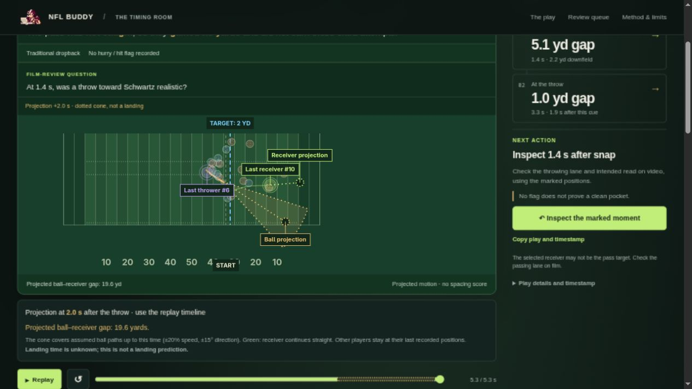

<div align="center">


# NFL Buddy 

### Failed third downs, built for NFL film review.

**See the situation. Know the result. Take one earlier moment to film.**

[](pyproject.toml)
[](outputs/multigame/report.html)
[](#data-and-scope)
[](uv.lock)
[](#development)

[Open live report](https://nflbuddy.nix.zone/) · [Questions it answers](#questions-it-answers) · [How it works](#how-it-works) · [Reproduce](#reproduce-the-analysis) · [Documentation](#documentation)

**Tracking data → Spacing history → Film-review queue**

</div>

## TL;DR

NFL Buddy helps coaches and analysts prepare a focused review of failed third-down passes: see the yards needed and actual result, inspect a specific receiver-spacing moment, and identify a question to check on game video.

The report groups **50 distinct plays** with **92 receiver cues**. It shows quarter, clock, score, recorded play type and play-level hurry/hit context, then suggests whether to inspect pressure, thrower movement or receiver timing first.

Copy the exact play, timestamp and measured observation to take into film review. It does not establish a missed pass or prescribe a coaching correction; the AI coaching-style review is not validation by a practicing coach.


## Explore the report

**[Open NFL Buddy →](https://nflbuddy.nix.zone/)** — no installation needed. For an offline copy, follow the steps below.

### 1. Get the project

```bash
git clone https://github.com/Claken/NFL-BigData.git
cd NFL-BigData
```

### 2. Open the report

Open [`outputs/multigame/report.html`](outputs/multigame/report.html) in your browser from the cloned repository. GitHub's file viewer shows the HTML source; use the local file to interact with it.

**No Python installation or data download is needed to explore the committed report.** Its charts and replay data are embedded, so it works offline. Keep the output folder together to retain the companion CSV, findings and image links.

### 3. Review a route

1. Read the sentences above the pitch: what the team needed to achieve and what actually happened. Quarter, clock and score give the game context.
2. Inspect the **first sustained spacing** moment, then compare positions at the throw.
3. Read **What to check first**: a recorded hurry/hit, thrower movement or receiver timing. Pressure flags apply to the whole play; their timing is unknown.
4. Use **Copy play and timestamp** to take the selected moment into film review.
5. Choose another play in the chronological queue, then switch between its qualifying receivers. Filter by receiver, recorded play type or coverage.

The old Part 03, all-downs statistics and Scott Miller comparison have been removed from the interface. Their original research artifacts remain available through labeled downloads.


## Questions it answers

| Question | What the report provides |
| --- | --- |
| What was the team trying to achieve, and what happened? | Down, yards needed, actual result, quarter, clock and score |
| Where should I begin inspecting receiver spacing? | The first sustained interval at/beyond the required line, with all 22 players shown |
| What should I check first? | A conditional review prompt using recorded dropback type and play-level hurry/hit flags |
| How do I take this into review? | Copyable play details with the receiver, timestamp, measured spacing and recorded result |

It cannot determine a safe passing lane, intended progression, hypothetical catch or why a play failed. A missing hurry flag does not prove a clean pocket. Catches short of the line followed by running gains are outside this screen.

## How plays are selected

From 923 eligible failed third-down pass plays (3,510 receiver routes), **299 plays / 588 routes** meet the spacing screen. The offline report includes a deliberately chosen Anthony Schwartz illustration plus **49 other plays sampled with seed 20261021**, retaining every qualifying receiver on each selected play. Cards are ordered by week/game/play, not coaching value. Multiple receivers on a play share one card.

The screen requires a nearest-defender gap strictly above 2 yards for at least 0.5 seconds (six consecutive 10 Hz samples), while at/beyond the yards-to-go and at least 2 yards downfield. It runs from snap+1 second through release−0.3 seconds. The **first** qualifying interval supplies the timestamp; missing/ineligible/below-threshold samples break it. Receivers still separated at the throw are included. These are transparent screening choices, not validated safe-pass thresholds.

Only incomplete passes, interceptions and completed passes short of the distance are eligible. Penalties, fumbles, scoring ambiguities, no-plays and goal-to-go situations are excluded; sacks and rushing plays are outside this pass review.

### Worked example

**Anthony Schwartz · CHI at CLE · game 2021092601, play 3345.** Cleveland needed 2 yards on third down, with 10:50 left in the fourth quarter and a 20–6 lead. The recorded short-right pass to H. Bryant was incomplete; Schwartz is the selected route, not the recorded target.

At **1.4 seconds**, Schwartz was **2.21 yards downfield** with **5.10 yards** to the nearest defender. The first qualifying interval spans 1.4–2.7 seconds; the throw is at 3.3 seconds. The play is recorded as a traditional dropback, with no hurry/hit flag recorded. That does not establish a clean pocket or an available throw.

**Review question:** Was Schwartz's spacing usable from the thrower's position at 1.4 seconds? Check the throwing lane and intended read on game video, and decide whether the tracking cue is useful.

### Archived original research

The all-downs spacing-history study has a different question and cohort: 3,598 / 10,870 routes close at release had sustained earlier spacing (33.1%). Its original analysis, sensitivity results and Scott Miller pair remain in the [findings](outputs/multigame/findings.md), [analysis JSON](outputs/multigame/analysis.json) and [static illustration](outputs/multigame/matched_pair.png). That result does not validate the failed-third-down screen.

## Features

| Capability | What you can do |
| --- | --- |
| **Synchronized replay** | Follow all 22 players, with the named thrower in purple and selected receiver in green |
| **Game situation** | See down-and-distance, a blue first-down or goal line, and the receiver's distance to it |
| **Recorded outcome** | See incomplete, completed short or intercepted, independently of the pre-throw animation |
| **Playback controls** | Play, pause and scrub through the last recorded post-release sample; then continue into the labeled projection on the same timeline; use At the throw to return to release |
| **Early ball flight** | See the recorded 0.2–0.5 seconds after release, with solid ball and receiver paths |
| **Motion projections** | Explore dotted ball-position envelopes and a straight receiver continuation as the shared replay timeline advances |
| **Field views** | Switch between Zoom to players and Show whole field with equal yard scales |
| **Play-based queue** | Browse 50 sampled plays, switch between qualifying receivers, and filter recorded play type |
| **Copy play details** | Copy the selected play, receiver, timestamp, measured spacing and recorded result |
| **Offline use and exports** | Explore embedded charts and replays, or use the companion CSV and PNG files |

### After the throw

Choose **After the throw** to play the recorded start of ball flight and its conditional continuation on one timeline. Solid gold and green paths connect measured ball and selected-receiver samples; animation interpolates between samples. Once tracking ends, a full dotted cone grows from the last measured ball position while a dotted green path continues the receiver's recent velocity. Other players remain dimmed at their last measured positions; the camera keeps the same scale throughout.

**This is an illustrative projection, not a predicted landing zone or catch probability.** The timeline continues up to 2 seconds after release; that horizon is chosen for exploration, not estimated from the throw: ball height and vertical velocity are missing. Motion is fitted from the last three consecutive post-release samples; one of the 50 plays has only two samples, so its three receiver cues show recorded motion without a projection. Both central projected positions refer to the same time; the gap does not establish a usable pass, and the selected receiver may not be the target.



## Data and scope

The analysis uses the [NFL Big Data Bowl regional event dataset](https://github.com/ThompsonJamesBliss/nfl-big-data-bowl-regional-event-data/tree/85da22eeff2f1d5be106faa9dfe06a1205f2defd), pinned to an immutable source commit.

| Scope | Included |
| --- | ---: |
| Season | 2021, Weeks 1–8 |
| Games | 122 |
| Plays contributing eligible routes | 7,217 |
| Eligible receiver routes | 26,050 |
| Eligible routes close at release | 10,870 |

Eligibility covers WR/TE/RB pass-route roles on completed, incomplete or intercepted passes, with validated timing, complete player tracking, a known line of scrimmage, in-bounds receiver tracks, at least 1.8 seconds observed and a receiver reaching at least 2 yards downfield. All eligible receivers on a play are evaluated; target identity is not assumed. Sacks and scrambles are excluded.

Input checksums and source URLs are recorded in the [dataset manifest](data/multigame_manifest.json). Raw downloads and rebuildable frame caches are excluded from Git.

## Interpretation and limits

> [!IMPORTANT]
> This is an exploratory spacing-history tool. Nearest-defender distance does not capture passing lanes, leverage, coverage responsibility, quarterback reads or whether the receiver was a viable target.

- **The 33.1% result applies to the eligible close-at-release routes**, not all routes or all dropbacks.
- **The offline queue is a reproducible sample plus one deliberate illustration.** It is not a priority ranking; extended plays still have more time to meet the screen.
- **Coverage and alignment comparisons are descriptive.** They do not establish coverage effects or rank receiver quality.
- **Queue filters affect browsing only.** They do not recalculate the aggregate result.
- **The interval describes variation across sampled games.** It does not measure tracking accuracy or guarantee results in another season.
- **An AI coaching-style review challenged the workflow.** No independent validation by a practicing coach, utility study or demonstration of improved conversions has been performed.

## Reproduce the analysis

You need **Python 3.12** and [uv](https://docs.astral.sh/uv/). From the repository root:

```bash
uv sync --locked
uv run --locked python scripts/build.py --fetch
```

The build downloads missing inputs, verifies their SHA-256 checksums, runs the analysis and rebuilds the report. The complete source download is approximately **865 MB**. Python and dependencies are pinned by `.python-version` and `uv.lock`.

See [REPRODUCE.md](REPRODUCE.md) for custom paths, caching, event policies, output details and the original one-game audit.

## Development

```bash
uv run --locked pytest -q
uv run --locked ruff check scripts tests
# Optional Node.js checks for the browser projection geometry:
node --test tests/test_flight_projection.cjs
```

The tests cover failed-third-down outcomes and exclusions, sustained beyond-line windows, metric rules, recorded thrower identity and replay geometry. The selected receiver is the route being studied, not necessarily the intended target. The packaged replays also have [420 independent distance checks](outputs/multigame/replay_independent_checks.csv), recomputed from the original defender coordinates. These checks validate the calculations, not whether a spacing window was a usable football opportunity.

## Documentation

| Resource | What it contains |
| --- | --- |
| [Interactive report](outputs/multigame/report.html) | Main finding, route review, evidence, methods and downloads |
| [Detailed findings](outputs/multigame/findings.md) | Definitions, comparisons, uncertainty and limitations |
| [Reproduction guide](REPRODUCE.md) | Locked build commands, provenance, exclusions and output inventory |
| [Deployment guide](deploy/README.md) | Live hosting, updates and rollback on the VPS |
| [Film-review queue](outputs/multigame/film_review_queue.csv) | The 50 selected routes and their window metrics |
| [All eligible routes](outputs/multigame/routes.csv) | Derived metrics for all 26,050 eligible routes |
| [Analysis results](outputs/multigame/analysis.json) | Group rates, bootstrap intervals, sensitivities and exclusions |
| [Matched-pair image](outputs/multigame/matched_pair.png) | Static comparison for presentations or export |
| [Verification record](outputs/multigame/verification.json) | Recorded calculation and report checks |

Built for the NFL Big Data Bowl regional event side quest. The organizer confirmed that the provided 2021 data is acceptable; see the [event brief](outputs/event_brief.md).
