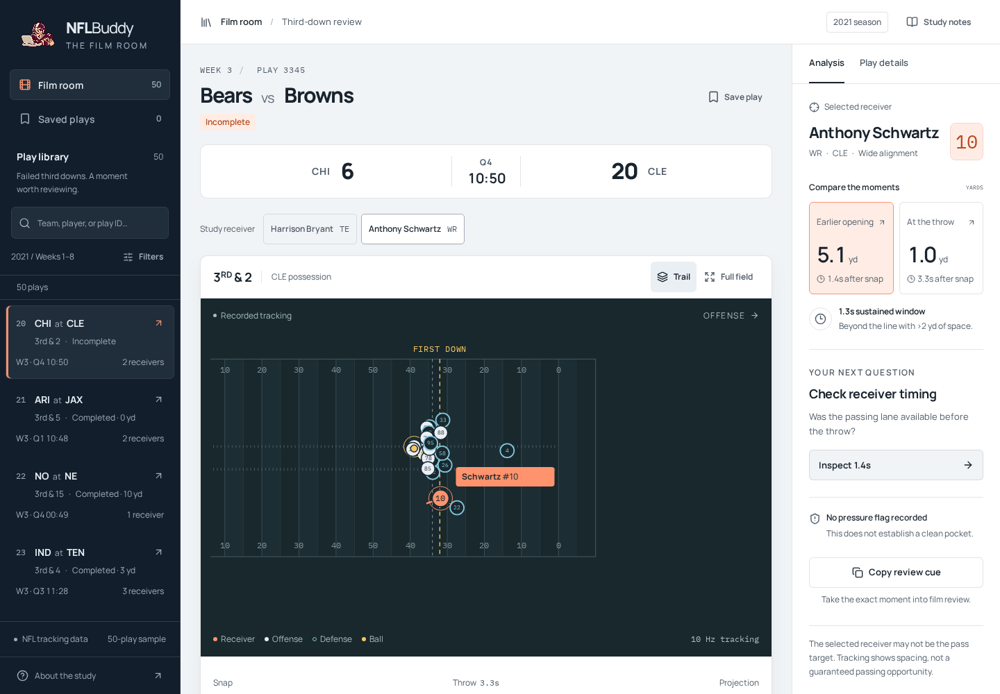

# NFL Buddy

A film-study workspace for failed NFL third downs. Browse 50 plays, replay recorded positions, compare 92 receiver cues, and copy a precise question for game-video review.



## Run the app

Use Node.js 22.12 or newer and pnpm. The committed analysis outputs contain the data needed to run the app; Python is only required to regenerate the analysis.

```bash
pnpm install --frozen-lockfile
pnpm dev
```

Open **http://localhost:5173**. For a production build:

```bash
pnpm build
pnpm preview
```

The build writes `dist/`, including local fonts, the play index, 92 tracking files, and research downloads. `index.html` and `report.html` both load the React app. Serve the folder over HTTP; opening its HTML directly with a `file://` URL will not load the data.

The [public site](https://nflbuddy.nix.zone/) reflects the last deployed release. See [deployment instructions](deploy/README.md) to publish a reviewed build.

## Use the film room

- Search the library by team, player, or play ID. Filter by week and coverage.
- Read the dedicated scoreboard for team scores, quarter, and game clock at the selected play.
- Choose a play, then switch between its qualifying receivers above the field.
- Compare **Earlier opening** with **At the throw** in the analysis panel. Use Play, the time slider, or frame-step buttons to inspect motion.
- Click **Throw** above the timeline to play from release to the last recorded frame. Enable **Illustrative projection** to opt into assumed continuation. Solid paths are recorded; dotted paths are assumed continuation.
- Save a play to keep it in this browser. Copy the review cue to take its game ID, timestamp, and observation into film review. A green checkmark and tint confirm a successful copy.
- Open **Play details** for the official record and **Study notes** for methods, limits, and downloads.

The selected receiver may not be the pass target. Spacing alone does not establish a safe throw or a missed opportunity.

## Frontend

The app uses [React](https://react.dev/) with TypeScript and [Vite](https://vite.dev/guide/). [Radix](https://www.radix-ui.com/primitives/docs/components/dialog) provides dialogs and tabs; [Lucide](https://lucide.dev/guide/react/) supplies icons. Components, SVG field rendering, and playback state live in `web/src/`. Styles use semantic OKLCH tokens, locally hosted Manrope and IBM Plex Mono, and responsive layouts. The original 8-bit football-and-computer mascot appears in the sidebar, mobile header, and browser tab.

`pnpm prepare:data` reads `outputs/multigame/replay_data.json` and prepares the frontend data. Each receiver's tracking loads on demand. The Python analysis and its original standalone HTML export remain available independently under `scripts/` and `outputs/multigame/`.

Team logos are downloaded and served locally from `web/public/teams/`. The [nflverse logo catalog](https://github.com/nflverse/nflverse-pbp/blob/master/teams_colors_logos.csv) supplies ESPN image URLs; source URLs and hashes are recorded in `web/public/teams/sources.json`. These are current team identities rather than a historical 2021 logo set.

## Questions it answers

| Question | What the report provides |
| --- | --- |
| What was the team trying to achieve, and what happened? | Down, yards needed, actual result, quarter, clock and score |
| Where should I begin inspecting receiver spacing? | The first sustained interval at/beyond the required line, with all 22 players shown |
| What should I check first? | A conditional review prompt using recorded dropback type and play-level hurry/hit flags |
| How do I take this into review? | Copyable play details with the receiver, timestamp, measured spacing and recorded result |

It cannot determine a safe passing lane, intended progression, hypothetical catch or why a play failed. A missing hurry flag does not prove a clean pocket. Catches short of the line followed by running gains are outside this screen.

## How plays are selected

From 923 eligible failed third-down pass plays (3,510 receiver routes), **299 plays / 588 routes** meet the spacing screen. The sample includes a deliberately chosen Anthony Schwartz illustration plus **49 other plays sampled with seed 20261021**, retaining every qualifying receiver on each selected play. Cards are ordered by week/game/play, not coaching value. Multiple receivers on a play share one card.

The screen requires a nearest-defender gap strictly above 2 yards for at least 0.5 seconds (six consecutive 10 Hz samples), while at/beyond the yards-to-go and at least 2 yards downfield. It runs from snap+1 second through release−0.3 seconds. The **first** qualifying interval supplies the timestamp; missing/ineligible/below-threshold samples break it. Receivers still separated at the throw are included. These are transparent screening choices, not validated safe-pass thresholds.

Only incomplete passes, interceptions and completed passes short of the distance are eligible. Penalties, fumbles, scoring ambiguities, no-plays and goal-to-go situations are excluded; sacks and rushing plays are outside this pass review.

### Worked example

**Anthony Schwartz · CHI at CLE · game 2021092601, play 3345.** Cleveland needed 2 yards on third down, with 10:50 left in the fourth quarter and a 20–6 lead. The recorded short-right pass to H. Bryant was incomplete; Schwartz is the selected route, not the recorded target.

At **1.4 seconds**, Schwartz was **2.21 yards downfield** with **5.10 yards** to the nearest defender. The first qualifying interval spans 1.4–2.7 seconds; the throw is at 3.3 seconds. The play is recorded as a traditional dropback, with no hurry/hit flag recorded. That does not establish a clean pocket or an available throw.

**Review question:** Was Schwartz's spacing usable from the thrower's position at 1.4 seconds? Check the throwing lane and intended read on game video, and decide whether the tracking cue is useful.

### Archived original research

The all-downs spacing-history study has a different question and cohort: 3,598 / 10,870 routes close at release had sustained earlier spacing (33.1%). Its original analysis, sensitivity results and Scott Miller pair remain in the [findings](outputs/multigame/findings.md), [analysis JSON](outputs/multigame/analysis.json) and [static illustration](outputs/multigame/matched_pair.png). That result does not validate the failed-third-down screen.

## Features

| Capability | What you can do |
| --- | --- |
| **Synchronized replay** | Follow all 22 players, with a gold ring around the thrower and an orange selected receiver |
| **Game situation** | Read the dedicated team scoreboard and quarter/clock, plus down-and-distance and a yellow first-down line |
| **Recorded outcome** | See incomplete, completed short or intercepted, independently of the pre-throw animation |
| **Playback controls** | Play, pause and scrub through the last recorded post-release sample; optionally enable the labeled projection on the same timeline; use At the throw to return to release |
| **Early ball flight** | See the recorded 0.2–0.5 seconds after release, with solid ball and receiver paths |
| **Motion projections** | Explore dotted ball-position envelopes and a straight receiver continuation as the shared replay timeline advances |
| **Field views** | Switch between Fit view and Full field with equal yard scales |
| **Play-based queue** | Browse 50 sampled plays, switch between qualifying receivers, and filter by week or coverage |
| **Copy play details** | Copy the selected play, receiver, timestamp, measured spacing and recorded result |
| **Local use and exports** | Run the app locally and download research CSV/JSON files; the original standalone HTML remains available for offline use |

### After the throw

Choose **Throw** above the replay slider to play the recorded start of ball flight. Playback stops at the last recorded frame by default. Enable **Illustrative projection** to explore conditional continuation on the same timeline; it does not show the actual catch or outcome. Solid gold and orange paths connect measured ball and selected-receiver samples; animation interpolates between samples. Once tracking ends, a full dotted cone grows from the last measured ball position while a dotted orange path continues the receiver's recent velocity. Other players remain at their last measured positions; the camera keeps the same scale throughout.

**This is an illustrative projection, not a predicted landing zone or catch probability.** The timeline continues up to 2 seconds after release; that horizon is chosen for exploration, not estimated from the throw: ball height and vertical velocity are missing. Motion is fitted from the last three consecutive post-release samples; one of the 50 plays has only two samples, so its three receiver cues show recorded motion without a projection. Both central projected positions refer to the same time; the gap does not establish a usable pass, and the selected receiver may not be the target.

## Data and scope

The analysis uses the [NFL Big Data Bowl regional event dataset](https://github.com/ThompsonJamesBliss/nfl-big-data-bowl-regional-event-data/tree/85da22eeff2f1d5be106faa9dfe06a1205f2defd), pinned to an immutable source commit.

| Scope | Included |
| --- | ---: |
| Season | 2021, Weeks 1–8 |
| Games | 122 |
| Plays contributing eligible routes | 7,217 |
| Eligible receiver routes | 26,050 |
| Eligible routes close at release | 10,870 |

Eligibility covers WR/TE/RB pass-route roles on completed, incomplete or intercepted passes, with validated timing, complete player tracking, a known line of scrimmage, in-bounds receiver tracks, at least 1.8 seconds observed and a receiver reaching at least 2 yards downfield. All eligible receivers on a play are evaluated; target identity is not assumed. Sacks and scrambles are excluded.

Input checksums and source URLs are recorded in the [dataset manifest](data/multigame_manifest.json). Raw downloads and rebuildable frame caches are excluded from Git.

## Interpretation and limits

> [!IMPORTANT]
> This is an exploratory spacing-history tool. Nearest-defender distance does not capture passing lanes, leverage, coverage responsibility, quarterback reads or whether the receiver was a viable target.

- **The 33.1% result applies to the eligible close-at-release routes**, not all routes or all dropbacks.
- **The offline queue is a reproducible sample plus one deliberate illustration.** It is not a priority ranking; extended plays still have more time to meet the screen.
- **Coverage and alignment comparisons are descriptive.** They do not establish coverage effects or rank receiver quality.
- **Queue filters affect browsing only.** They do not recalculate the aggregate result.
- **The interval describes variation across sampled games.** It does not measure tracking accuracy or guarantee results in another season.
- **An AI coaching-style review challenged the workflow.** No independent validation by a practicing coach, utility study or demonstration of improved conversions has been performed.

## Reproduce the analysis

You need **Python 3.12** and [uv](https://docs.astral.sh/uv/). From the repository root:

```bash
uv sync --locked
uv run --locked python scripts/build.py --fetch
```

The build downloads missing inputs, verifies their SHA-256 checksums, runs the analysis and rebuilds the report. The complete source download is approximately **865 MB**. Python and dependencies are pinned by `.python-version` and `uv.lock`.

See [REPRODUCE.md](REPRODUCE.md) for custom paths, caching, event policies, output details and the original one-game audit.

## Development

```bash
pnpm typecheck
pnpm test
pnpm exec playwright install chromium
pnpm test:ui
pnpm build

# Analysis and original-export checks
uv run --locked pytest -q
uv run --locked ruff check scripts tests
# Optional Node.js checks for the browser projection geometry:
node --test tests/test_flight_projection.cjs
```

The tests cover failed-third-down outcomes and exclusions, sustained beyond-line windows, metric rules, recorded thrower identity and replay geometry. The selected receiver is the route being studied, not necessarily the intended target. The packaged replays also have [420 independent distance checks](outputs/multigame/replay_independent_checks.csv), recomputed from the original defender coordinates. These checks validate the calculations, not whether a spacing window was a usable football opportunity.

## Documentation

| Resource | What it contains |
| --- | --- |
| [React app](web/src/App.tsx) | Film-room shell, library, replay, analysis, and study notes |
| [Original offline export](outputs/multigame/report.html) | Standalone analysis report |
| [Detailed findings](outputs/multigame/findings.md) | Definitions, comparisons, uncertainty and limitations |
| [Reproduction guide](REPRODUCE.md) | Locked build commands, provenance, exclusions and output inventory |
| [Deployment guide](deploy/README.md) | Live hosting, updates and rollback on the VPS |
| [Film-review queue](outputs/multigame/film_review_queue.csv) | The 50 selected routes and their window metrics |
| [All eligible routes](outputs/multigame/routes.csv) | Derived metrics for all 26,050 eligible routes |
| [Analysis results](outputs/multigame/analysis.json) | Group rates, bootstrap intervals, sensitivities and exclusions |
| [Matched-pair image](outputs/multigame/matched_pair.png) | Static comparison for presentations or export |
| [Verification record](outputs/multigame/verification.json) | Recorded calculation and report checks |

Built for the NFL Big Data Bowl regional event side quest. The organizer confirmed that the provided 2021 data is acceptable; see the [event brief](outputs/event_brief.md).
